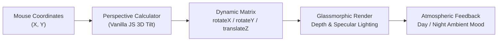

<div align="center">

# 🌤️ SKYORA — Next-Gen 3D Weather Platform

<p align="center">
  <strong>A futuristic, immersive 3D weather intelligence web application delivering real-time atmospheric telemetry and extended 7-day meteorological forecasts.</strong>
</p>

[](https://github.com/muskanji1007-lang/weather-website)
[](#technologies-used)
[](#3d-user-experience)
[](#technologies-used)
[](#api-integration)
[](#license)

<br/>

<p align="center">
  <a href="#-key-features">Key Features</a> •
  <a href="#-3d-user-experience">3D Experience</a> •
  <a href="#-weather-highlights-grid">7 Metric Cards</a> •
  <a href="#-7-day-forecast">7-Day Forecast</a> •
  <a href="#-quick-start">Quick Start</a> •
  <a href="#-api-documentation">API Docs</a> •
  <a href="#-author">Author</a>
</p>

---

</div>

## 📖 Overview

**SKYORA** redefines personal weather tracking through modern **3D glassmorphic aesthetics**, interactive perspective tilt physics, and deep atmospheric analytics. Built with vanilla web standards (HTML5, CSS3, JavaScript ES6+), it blends performance with high visual fidelity.

Whether monitoring real-time conditions, tracking barometric changes, checking UV safety levels, or planning ahead with the **7-Day Outlook**, Skyora presents complex weather data in an intuitive, dashboard layout.

---

## ✨ Key Features

| Feature | Description |
| :--- | :--- |
| 🎨 **Ocean & Coral Design** | Curated editorial aesthetic featuring Deep Teal (`#173C38`), Ocean Sage (`#28615B`), Warm Coral (`#E58D78`), Cream (`#F4E9D9`), and Sand (`#D6C5A5`). |
| 🏙️ **Dynamic City Skyline** | High-definition panoramic city hero banner adapting automatically to the searched location (Delhi, Mumbai, London, Tokyo, NYC, etc.). |
| 🪟 **3D Glassmorphic UI** | Multi-layered frosted glass panels with organic depth, subtle warm borders, and floating badges. |
| 🎛️ **Interactive 3D Tilt** | Dynamic mouse-tracking perspective calculations (`rotateX`, `rotateY`) on weather cards. |
| 📊 **7 Weather Metric Cards** | Dedicated telemetry for Feels Like, Humidity, Wind Status, UV Index, Air Pressure, Visibility, and Sun Cycle. |
| 📅 **Complete 7-Day Forecast** | Comprehensive weekly meteorological progression with daily min/max ranges and active today indicator. |
| ⚡ **One-Click Guest Demo** | Instant full-feature explore mode with zero signup friction. |
| 🌡️ **Unit Switcher (°C / °F)** | Global temperature conversion across hero metrics, cards, and forecast data. |
| 🏙️ **Quick City Chips** | One-tap access to major global cities (Delhi, Mumbai, London, New York, Tokyo, Paris, Dubai). |
| 🎯 **Luminous Custom Cursor** | Dual glowing particle cursor with magnetic hover expansion on clickable elements. |
| 🔔 **3D Toast Notifications** | Clean floating status alerts replacing intrusive native browser popups. |
| 🔐 **Authentication Flow** | Protected dashboard with token authorization, password visibility toggles, and form validation. |

---

## 🎨 3D User Experience & Visual Design

Skyora is crafted with a bespoke 3D design system:



- **Perspective Geometry**: Built on CSS `perspective(1000px)` and `transform-style: preserve-3d`.
- **Z-Axis Hierarchy**: Floating weather badges and icons elevate above the glass surface (`translateZ`).
- **Atmospheric Lighting**: Specular gradients and radial ambient backlights illuminate active cards.

---

## 🌦️ Weather Highlights Grid (7 Atmospheric Cards)

Instead of basic temperature stats, Skyora delivers **7 distinct atmospheric telemetry cards**:

1. 🌡️ **Feels Like**: Heat index and windchill calculations with human comfort ratings.
2. 💧 **Humidity**: Real-time atmospheric moisture percentage paired with a visual gauge and comfort levels.
3. 💨 **Wind Velocity**: Wind speed in km/h, animated directional compass arrow, and peak gust speeds.
4. ☀️ **UV Index**: Solar ultraviolet rating with color-coded safety badges (Low, Moderate, High, Extreme).
5. 🧭 **Air Pressure**: Barometric surface pressure (hPa/mb) with atmospheric stability rating.
6. 👁️ **Visibility**: Horizontal horizon clarity index (km) and smog/fog categorization.
7. 🌅 **Sun & Astro Cycle**: Golden hour telemetry displaying exact Sunrise and Sunset schedules.

---

## 📅 7-Day Meteorological Forecast

The weekly forecast displays 7 unified cards:
- **Active Day Highlight**: Highlighted cyan glowing border and "TODAY" badge for current day.
- **Micro-Weather Badges**: Floating condition iconography with smooth hover zoom.
- **Thermal Range**: Clear maximum and minimum temperature spread for every single day.
- **Consecutive Calendar Tracking**: Full weekday and date progression.

---

## 🔌 API Architecture & Endpoints

Skyora connects to a cloud weather proxy service secured with Bearer token authentication:

### 🔑 Authentication Endpoints
```http
POST /api/auth/signup
Content-Type: application/json
Body: { "name": "...", "email": "...", "password": "..." }

POST /api/auth/login
Content-Type: application/json
Body: { "email": "...", "password": "..." }
```

### 🛰️ Weather Telemetry Endpoints
```http
GET /api/weather/current?city={cityName}
Authorization: Bearer <TOKEN>

GET /api/weather/forecast?city={cityName}&days=7
Authorization: Bearer <TOKEN>

GET /api/weather/search?q={query}
Authorization: Bearer <TOKEN>
```

---

## 💻 Tech Stack

- **Markup**: Semantic HTML5 with accessibility attributes (`aria-live`, responsive viewports).
- **Styling**: Modern CSS3 (Custom Variables, Flexbox, CSS Grid, Glassmorphism, 3D Keyframe Animations).
- **Scripting**: Vanilla JavaScript (ES6+ Async/Await, Fetch API, DOM Manipulation, Custom Events).
- **Icons**: Font Awesome 6 + Dynamic SVG Favicon.
- **Typography**: Google Fonts (*Outfit* and *Plus Jakarta Sans*).

---

## 📁 Project Structure

```text
weather-website/
├── 📄 index.html          # Semantic application layout & 3D DOM structure
├── 🎨 style.css           # Glassmorphism design system, 3D tilt, and responsive layout
├── ⚡ script.js           # 3D tilt physics, API coordinator, 7-card telemetry & state
├── 📖 README.md           # Project documentation and specifications
└── 🖼️ assets/             # Atmospheric high-resolution backgrounds & visual assets
```

---

## 🚀 Quick Start & Installation

To run Skyora locally on your machine:

1. **Clone the repository**:
   ```bash
   git clone https://github.com/muskanji1007-lang/weather-website.git
   cd weather-website
   ```

2. **Launch with any local static server**:
   - **Using VS Code**: Right-click `index.html` and choose **"Open with Live Server"**.
   - **Using Node.js**:
     ```bash
     npx serve .
     ```
   - **Using Python**:
     ```bash
     python -m http.server 5500
     ```

3. **Experience the Application**:
   - Click **"Explore as Guest / Demo"** for instant access without registration.
   - Or create an account with email and password to use live authenticated tokens.
   - Search any city globally or click any popular city chip.

---

## 👩‍💻 Author & Contributions

Created with 💙 by **Muskan Gupta**

- **GitHub Profile**: [@muskanji1007-lang](https://github.com/muskanji1007-lang)
- **Repository**: [muskanji1007-lang/weather-website](https://github.com/muskanji1007-lang/weather-website)

---

## 📄 License

This project is licensed under the **MIT License** — feel free to use, modify, and build upon it.
